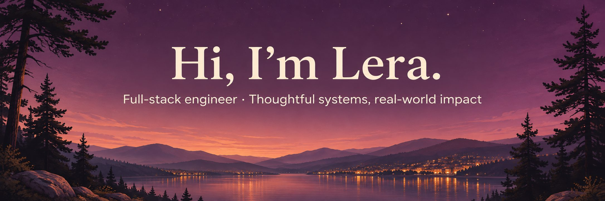
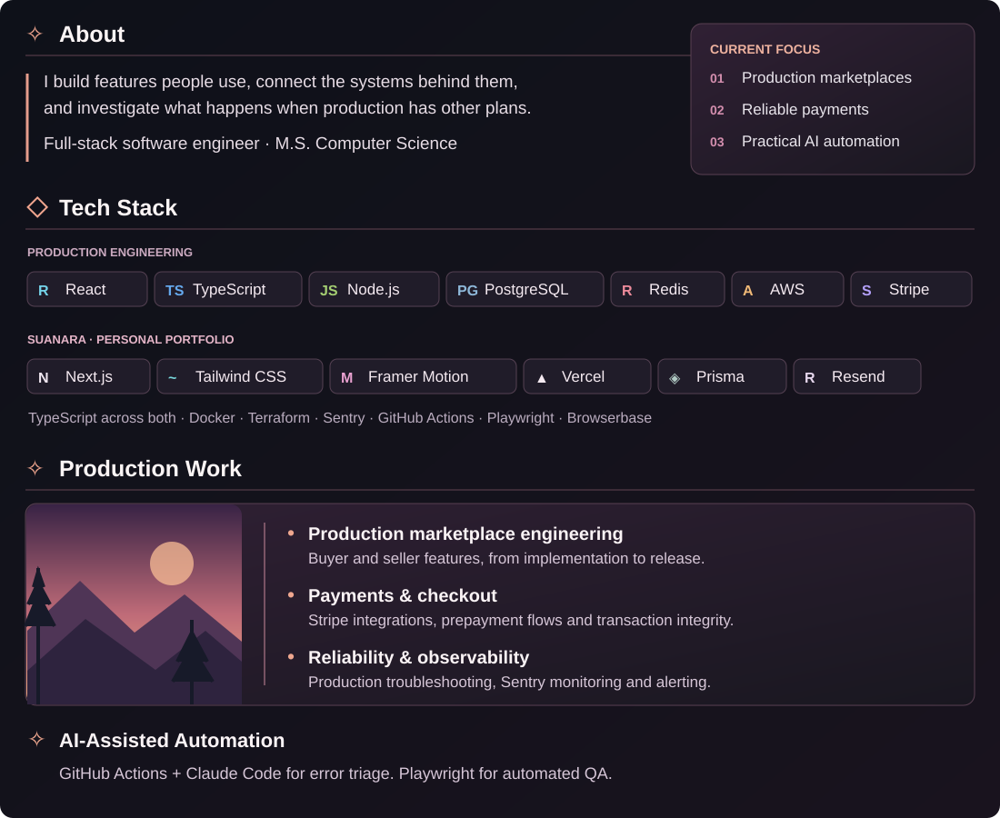

<a href="https://suanara.dev"><strong>Explore Suanara →</strong></a> · <a href="https://github.com/leracraft/portfolio">Portfolio source</a>

About &amp; technology — text version

## 🌱 About

I’m Lera Suanu, a full-stack software engineer. I build features people use, connect the systems behind them, and investigate what happens when production has other plans.

My work spans React interfaces, Node.js APIs, PostgreSQL data models, Stripe payments, and the monitoring and automation that help keep everything running.

## 🚀 What I work on

- **Production marketplace engineering:** taking buyer and seller experiences from implementation through release and ongoing support at ReefnBid.
- **Payments & checkout:** Stripe integrations, prepayment flows, transaction integrity, and concurrency controls.
- **Reliability & observability:** production troubleshooting, Sentry monitoring, error classification, and alerting.
- **Developer automation:** automated error triage with GitHub Actions and Claude Code, alongside Playwright-based quality assurance.

## 🛠️ Tech stack

**Production engineering**

**Suanara · [suanara.dev](https://suanara.dev)**

My personal portfolio, built with attention to interface design and motion.

**Cloud, quality & delivery**

AWS · Docker · Terraform · GitHub Actions · Sentry · Playwright · Browserbase

---

<em>Thoughtful interfaces. Reliable systems. Always something worth learning.</em>

